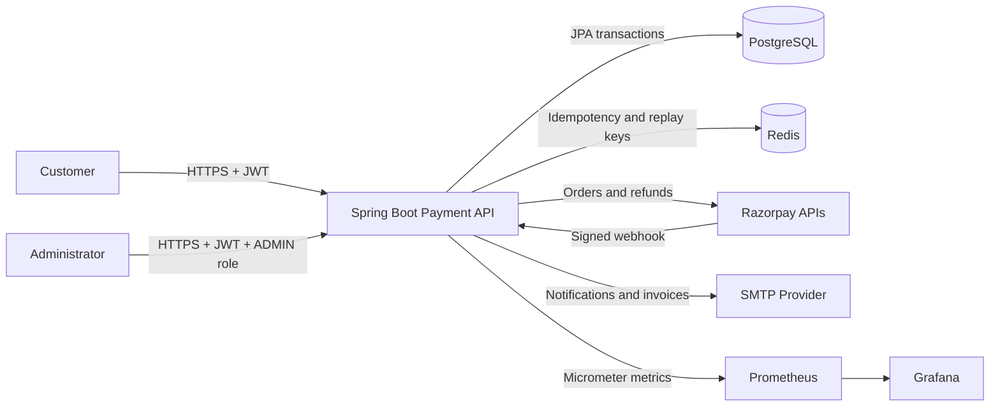
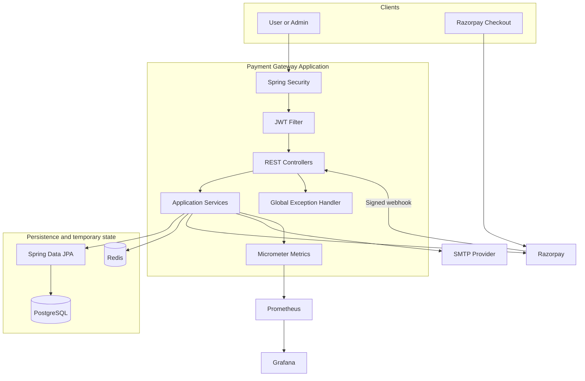
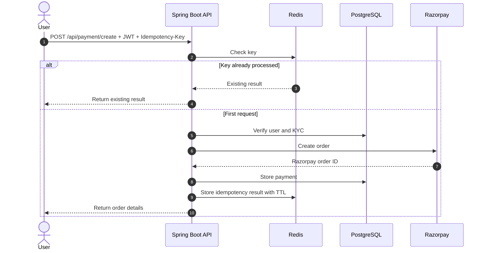
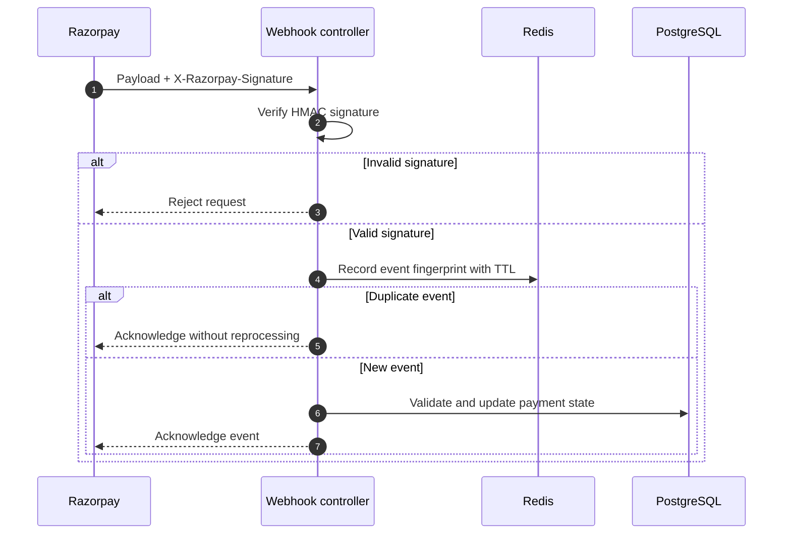

# Secure Payment Gateway


A production-oriented Spring Boot REST API for secure payment processing, user KYC, refunds, invoices, and administrative payment operations.

The project demonstrates the engineering concerns that make payment systems different from basic CRUD applications:

- JWT authentication and role-based authorization
- PostgreSQL as the durable system of record
- Redis-backed idempotency and webhook replay protection
- Razorpay order, webhook, and refund integration
- KYC-gated payment operations
- Centralized, structured API error responses
- Docker Compose for a reproducible local environment
- OpenAPI/Swagger documentation
- Actuator health endpoints and Prometheus metrics

> **Scope:** This repository is a portfolio and interview-ready payment gateway implementation. Live Razorpay transactions, SMTP delivery, and production deployment require valid external credentials and infrastructure.

---

## Table of contents

- [Features](#features)
- [Architecture](#architecture)
- [Payment and security flows](#payment-and-security-flows)
- [Technology stack](#technology-stack)
- [Project structure](#project-structure)
- [Quick start with Docker](#quick-start-with-docker-recommended)
- [Configuration](#configuration)
- [API reference](#api-reference)
- [Authentication and authorization](#authentication-and-authorization)
- [Observability](#observability)
- [Testing](#testing)
- [Screenshots](#screenshots)
- [Troubleshooting](#troubleshooting)
- [Production considerations](#production-considerations)
- [Interview summary](#interview-summary)
- [License](#license)

---

## Features

### Authentication and account management

- Email/password login with BCrypt password hashing
- Google authentication entry point
- Email verification and password setup
- Forgot-password and reset-password flows
- JWT-based stateless authentication
- Clear `401 Unauthorized` and `403 Forbidden` responses

### User and KYC management

- User profile endpoint
- KYC submission with request validation
- Admin KYC review, approval, and rejection
- Payment operations can require approved KYC

### Payments

- Razorpay order creation
- Payment history for the authenticated user
- Idempotency-key protection against duplicate payment creation
- Razorpay webhook signature verification
- Webhook replay protection
- Payment state validation
- User refund requests
- Admin refund approval and processing
- PDF invoice generation and email delivery

### Administration

- List and search users
- Enable, disable, and delete users
- View and manage KYC records
- View all payments
- Search payments by user ID or name
- View user payment summaries
- Process refunds

### Reliability and operations

- PostgreSQL persistence
- Redis for short-lived protection keys
- Centralized `ProblemDetail`-style API errors
- Request IDs for unexpected server errors
- Dockerized API, PostgreSQL, and Redis
- Swagger UI/OpenAPI documentation
- Actuator health, liveness, readiness, and Prometheus endpoints
- GitHub Actions validation, tests, and package build

---

## Architecture

### System context



### Runtime components



### Layered request path

```text
HTTP request
    ↓
Spring Security and JWT filter
    ↓
REST controller and Bean Validation
    ↓
Application service and business rules
    ↓
Repository / Redis / external provider
    ↓
Structured HTTP response
```

PostgreSQL is the source of truth for users, KYC, payments, and related business records. Redis stores short-lived data such as idempotency results and processed webhook keys; it is not a replacement for the database.

### Payment creation and idempotency



### Webhook verification and replay protection



### Refund workflow

```text
User requests refund
    ↓
Ownership and payment-state checks
    ↓
Refund request stored and administrator notified
    ↓
Administrator approves or rejects
    ↓
Approved request calls Razorpay refund API
    ↓
Payment/refund state and user notification are updated
```

---

## Payment and security flows

### Login

1. The client sends an email and password.
2. Bean Validation checks the request.
3. The user is loaded from PostgreSQL.
4. BCrypt verifies the password.
5. The API returns a signed JWT.
6. The client sends the JWT as `Authorization: Bearer <token>` on protected requests.

### Why idempotency is required

Networks fail and clients retry. Without an idempotency key, a timeout can cause the same payment action to create two orders. The API requires a unique `Idempotency-Key` header and uses Redis to recognize repeated requests.

### Why webhook signatures are verified

The webhook URL is reachable by external systems. Signature verification prevents an attacker from sending a fake payment-success request. Replay protection makes repeated delivery of the same valid event safe.

### Error handling

The global exception handler maps failures to predictable responses:

| Situation | HTTP status |
| --- | ---: |
| Invalid request or field validation | `400` |
| Missing or invalid authentication | `401` |
| Authenticated user lacks permission | `403` |
| Resource does not exist | `404` |
| Business conflict, such as incomplete KYC | `409` |
| Unexpected server failure | `500` |

Unexpected errors return safe messages rather than stack traces or internal implementation details. A request ID is included so the failure can be correlated with server logs.

---

## Technology stack

| Category | Technology |
| --- | --- |
| Language | Java |
| Framework | Spring Boot 4.0.2 |
| Build | Maven |
| Java source level | 17 |
| Container runtime | Eclipse Temurin Java 21 |
| Web/API | Spring MVC |
| Security | Spring Security, JWT, BCrypt |
| Persistence | Spring Data JPA, PostgreSQL |
| Temporary state | Spring Data Redis, Redis 7 |
| Payment provider | Razorpay Java SDK |
| Validation | Jakarta Bean Validation |
| Invoice generation | OpenPDF |
| Email | Spring Mail/SMTP |
| API documentation | Springdoc OpenAPI/Swagger UI |
| Metrics | Actuator, Micrometer, Prometheus registry |
| Local orchestration | Docker Compose |
| CI | GitHub Actions |

---

## Project structure

```text
.
├── .github/workflows/ci.yml
├── docker-compose.yml
├── README.md
└── paymentgateway/
    ├── Dockerfile
    ├── pom.xml
    ├── mvnw
    └── src/
        ├── main/java/com/gateway/paymentgateway/
        │   ├── config/
        │   ├── controller/
        │   ├── dto/
        │   ├── entity/
        │   ├── exception/
        │   ├── repository/
        │   ├── security/
        │   ├── service/
        │   └── metrices/
        └── main/resources/
            ├── application.properties
            └── templates/
```

Important areas:

- `controller/` — REST endpoints
- `service/` — business rules and provider integration
- `repository/` — PostgreSQL data access
- `security/` — JWT filter and authorization configuration
- `exception/` — typed API exceptions and global error mapping
- `config/` — Razorpay, Redis, Swagger, and admin initialization
- `dto/` — validated request and response models

---

## Quick start with Docker (recommended)

### Prerequisites

- Git
- Docker Desktop or Docker Engine with Docker Compose

### Clone and start

```bash
git clone https://github.com/NIHAL29SINGH/securepaymentprivategateway.git
cd securepaymentprivategateway
docker compose up --build
```

The Compose file starts:

| Service | Address | Purpose |
| --- | --- | --- |
| `app` | `http://localhost:8080` | Spring Boot API |
| `postgres` | `localhost:5432` | PostgreSQL 16 |
| `redis` | `localhost:6379` | Redis 7 |

The database and Redis containers have health checks. The application waits for both dependencies to become healthy before starting.

### Verify the application

```bash
docker compose ps
curl http://localhost:8080/actuator/health
```

Open Swagger in a browser:

```text
http://localhost:8080/swagger-ui/index.html
```

### Run in the background

```bash
docker compose up --build -d
docker compose logs -f app
```

### Stop the environment

```bash
docker compose down
```

To remove the local PostgreSQL volume and all locally stored database data:

```bash
docker compose down -v
```

Use `down -v` only when intentionally resetting the local environment.

---

## Configuration

### Local Docker defaults

The Compose file supplies development-only values:

| Variable | Local value | Purpose |
| --- | --- | --- |
| `DB_URL` | `jdbc:postgresql://postgres:5432/paymentgateway` | Database connection |
| `DB_USERNAME` | `payment` | Database user |
| `DB_PASSWORD` | `payment` | Database password |
| `JPA_DDL_AUTO` | `update` | Local schema behavior |
| `REDIS_HOST` | `redis` | Redis service name |
| `REDIS_PORT` | `6379` | Redis port |
| `JWT_SECRET` | Development placeholder | JWT signing secret |
| `ADMIN_EMAIL` | `admin@example.com` | Local admin account |
| `ADMIN_PASSWORD` | Development placeholder | Local admin password |
| `RAZORPAY_KEY_ID` | `local` | Placeholder provider key |
| `RAZORPAY_KEY_SECRET` | `local` | Placeholder provider secret |
| `RAZORPAY_WEBHOOK_SECRET` | `local` | Placeholder webhook secret |

**Do not use these values in production.** Replace them through environment variables or a secret manager.

### External integrations

For real Razorpay sandbox/production testing, configure:

```bash
export RAZORPAY_KEY_ID="your-key-id"
export RAZORPAY_KEY_SECRET="your-key-secret"
export RAZORPAY_WEBHOOK_SECRET="your-webhook-secret"
```

For Google authentication:

```bash
export GOOGLE_CLIENT_ID="your-google-client-id"
```

For SMTP email:

```bash
export MAIL_HOST="smtp.example.com"
export MAIL_PORT="587"
export MAIL_USERNAME="your-smtp-user"
export MAIL_PASSWORD="your-smtp-password"
export MAIL_HEALTH_ENABLED="true"
```

The mail health indicator is disabled by default so local health checks do not fail when SMTP is not configured.

### Running without Docker

Docker is recommended. If running the application directly, provide PostgreSQL and Redis separately, use Java 17 or newer, and set the required environment variables before starting Maven:

```bash
cd paymentgateway
./mvnw spring-boot:run
```

On Windows:

```bat
mvnw.cmd spring-boot:run
```

At minimum, direct execution requires valid values for `DB_URL`, `DB_USERNAME`, `DB_PASSWORD`, `JWT_SECRET`, `RAZORPAY_KEY_ID`, `RAZORPAY_KEY_SECRET`, and `RAZORPAY_WEBHOOK_SECRET`.

---

## API reference

Base URL:

```text
http://localhost:8080
```

Protected endpoints require:

```http
Authorization: Bearer <JWT>
```

Payment creation additionally requires:

```http
Idempotency-Key: <unique-request-key>
```

### Authentication

| Method | Endpoint | Authentication | Request |
| --- | --- | --- | --- |
| `POST` | `/api/auth/login` | Public | JSON login credentials |
| `POST` | `/api/auth/google` | Public | JSON containing `idToken` |
| `POST` | `/api/auth/verify?token=...` | Public | JSON containing `password` |
| `POST` | `/api/auth/forgot-password?email=...` | Public | Query parameter |
| `POST` | `/api/auth/reset-password?token=...&newPassword=...` | Public | Query parameters |

Example login:

```bash
curl -X POST http://localhost:8080/api/auth/login \
  -H "Content-Type: application/json" \
  -d '{"email":"admin@example.com","password":"local-admin-password-change-me"}'
```

The local admin is initialized from the Compose environment. Copy the returned JWT for protected requests.

### User endpoints

| Method | Endpoint | Authentication | Purpose |
| --- | --- | --- | --- |
| `GET` | `/api/user/profile` | User JWT | View the authenticated user's profile |
| `POST` | `/api/user/kyc` | User JWT | Submit KYC data |
| `GET` | `/api/user/payments` | User JWT | View the authenticated user's payments |

### Payment endpoints

| Method | Endpoint | Authentication | Purpose |
| --- | --- | --- | --- |
| `POST` | `/api/payment/create?amount=500` | User JWT + idempotency key | Create a Razorpay order |
| `GET` | `/api/payment/history` | User JWT | View payment history |
| `POST` | `/api/payment/refund/request?paymentId=1` | User JWT | Request a refund |
| `POST` | `/api/payment/webhook` | Provider signature | Process a Razorpay webhook |
| `POST` | `/api/payments/invoice/pdf` | Authenticated request | Generate/send an invoice PDF |
| `GET` | `/pay?orderId=...` | Public | Render the Razorpay checkout page |

Example payment request:

```bash
curl -X POST "http://localhost:8080/api/payment/create?amount=500" \
  -H "Authorization: Bearer YOUR_JWT" \
  -H "Idempotency-Key: payment-001"
```

### Admin user and KYC endpoints

All endpoints below require an administrator JWT.

| Method | Endpoint | Purpose |
| --- | --- | --- |
| `GET` | `/api/admin/users` | List users |
| `GET` | `/api/admin/users/email/{email}` | Find a user by email |
| `GET` | `/api/admin/users/id/{id}` | Find a user by ID |
| `PUT` | `/api/admin/users/{id}/disable` | Disable a user |
| `PUT` | `/api/admin/users/{id}/enable` | Enable a user |
| `DELETE` | `/api/admin/users/{id}` | Delete a user |
| `GET` | `/api/admin/kyc/{userId}` | View user KYC |
| `POST` | `/api/admin/kyc/approve/{userId}` | Approve KYC |
| `POST` | `/api/admin/kyc/reject/{userId}?reason=...` | Reject KYC |

### Admin payment endpoints

All endpoints below require an administrator JWT.

| Method | Endpoint | Purpose |
| --- | --- | --- |
| `GET` | `/api/admin/payments` | List all payments |
| `GET` | `/api/admin/payments/user/{userId}` | List payments by user ID |
| `GET` | `/api/admin/payments/user?name=...` | Search payments by user name |
| `POST` | `/api/admin/payments/refund/{paymentId}` | Approve and process a refund |
| `GET` | `/api/admin/payments/summary/users` | Payment summary for all users |
| `GET` | `/api/admin/payments/summary/users/email?email=...` | Summary by email |
| `GET` | `/api/admin/payments/summary/users/id/{userId}` | Summary by user ID |
| `GET` | `/api/admin/payments/summary/users/name?name=...` | Summary by user name |

### Operational endpoints

| Method | Endpoint | Access | Purpose |
| --- | --- | --- | --- |
| `GET` | `/actuator/health` | Public | Overall health |
| `GET` | `/actuator/health/liveness` | Public | Process liveness |
| `GET` | `/actuator/health/readiness` | Public | Dependency readiness |
| `GET` | `/actuator/prometheus` | Admin JWT | Prometheus metrics |
| `GET` | `/swagger-ui/index.html` | Public | Interactive API documentation |
| `GET` | `/v3/api-docs` | Public | OpenAPI document |

---

## Authentication and authorization

- `/api/auth/**`, Swagger, health endpoints, and the Razorpay webhook entry point are public.
- `/api/admin/**` requires the `ADMIN` role.
- Other application endpoints require a valid JWT.
- Sessions are stateless; the server does not use a traditional HTTP session.
- CSRF is disabled for this stateless JWT API.
- Passwords are hashed with BCrypt.
- The webhook endpoint is public at the HTTP security layer but must validate the Razorpay signature before changing payment state.

---

## Observability

The application exposes:

```text
/actuator/health
/actuator/health/liveness
/actuator/health/readiness
/actuator/prometheus
```

Metrics include payment and user signals such as:

- `payments_created_total`
- `payments_success_total`
- `payments_failure_total`
- `payments_refunded_total`
- `payments_revenue_total`
- `payments_refunded_amount_total`
- `total_users`

The repository includes screenshots of Grafana dashboards, but Prometheus and Grafana are not services in the current `docker-compose.yml`. To use them, run those tools separately and configure Prometheus to scrape the application metrics endpoint.

---

## Testing

Run the Maven test suite inside the application module:

```bash
cd paymentgateway
./mvnw -B test
```

Run validation and package steps:

```bash
./mvnw -B validate
./mvnw -B package
```

Run the tests through Docker Compose:

```bash
docker compose run --rm app mvn test
```

GitHub Actions runs on pushes and pull requests and performs:

1. Maven validation
2. Maven tests
3. Spring Boot package build

The Docker image build itself skips tests because CI runs the test phase separately.

---

## Screenshots

The repository contains examples of:

- Grafana business dashboards
- Razorpay checkout
- Successful payment response
- OAuth playground
- Redis idempotency keys
- Ngrok webhook delivery
- Successful webhook processing


.png)


---

## Troubleshooting

### The application does not start

Check dependency health and logs:

```bash
docker compose ps
docker compose logs postgres
docker compose logs redis
docker compose logs app
```

### Port already in use

Stop the process using port `8080`, `5432`, or `6379`, or change the host-side port mapping in `docker-compose.yml`.

### Health is not `UP`

Check the readiness endpoint and application logs:

```bash
curl http://localhost:8080/actuator/health
docker compose logs -f app
```

SMTP health is disabled by default. If it was explicitly enabled, verify the mail host, port, username, password, and TLS settings.

### Login fails

When using the default Docker environment, use:

```text
Email:    admin@example.com
Password: local-admin-password-change-me
```

If the database volume was reused, the existing administrator record may have an older password. Reset the local environment only when it is safe to remove local data:

```bash
docker compose down -v
docker compose up --build
```

### Payment creation fails

Confirm that:

- The JWT is valid.
- The request includes a positive `amount`.
- The request includes an `Idempotency-Key`.
- The user satisfies the KYC/business requirements.
- Real Razorpay credentials are configured for external payment processing.

---

## Production considerations

Before production use, replace development defaults and add environment-specific controls:

- Store secrets in a secret manager rather than source-controlled configuration.
- Use a strong rotated JWT secret.
- Use managed PostgreSQL and Redis with backups and access controls.
- Set `JPA_DDL_AUTO=validate` and use a migration tool such as Flyway or Liquibase.
- Configure HTTPS and secure webhook delivery.
- Add rate limiting and abuse protection.
- Add structured log shipping, tracing, and alerting.
- Add broader integration, contract, load, and security tests.
- Validate Razorpay sandbox behavior end to end.
- Configure SMTP with provider credentials and delivery monitoring.
- Add audit logging for sensitive administrator actions.

---

## Interview summary

> This project is a secure payment gateway backend built with Spring Boot. It supports JWT authentication, KYC, Razorpay order creation, refunds, invoices, and administrative payment management. PostgreSQL stores durable business data, while Redis protects against duplicate requests and repeated webhook delivery. The most important reliability features are idempotency keys for payment creation and Razorpay webhook signature verification with replay protection. The API also provides centralized structured errors, Docker Compose startup, Swagger documentation, Actuator health checks, Prometheus metrics, and CI validation.

### Strongest technical talking points

1. **Idempotency:** retries do not create duplicate payment orders.
2. **Webhook security:** unsigned or invalid provider events cannot update payment state.
3. **Authorization:** normal users and administrators have separate capabilities.
4. **Error contracts:** clients receive consistent status codes and safe details.
5. **Operational readiness:** the application has health checks, metrics, Docker startup, and CI verification.

---

## License

This project is licensed under the MIT License.

Third-party dependencies remain subject to their own licenses, including the Apache License 2.0 for Prometheus and Grafana.

## Author

**Nihal Singh**
